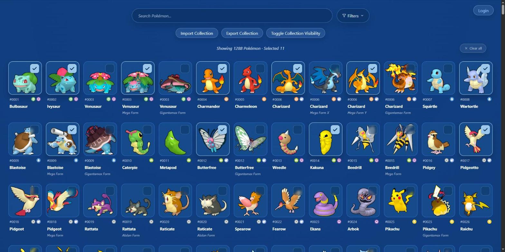
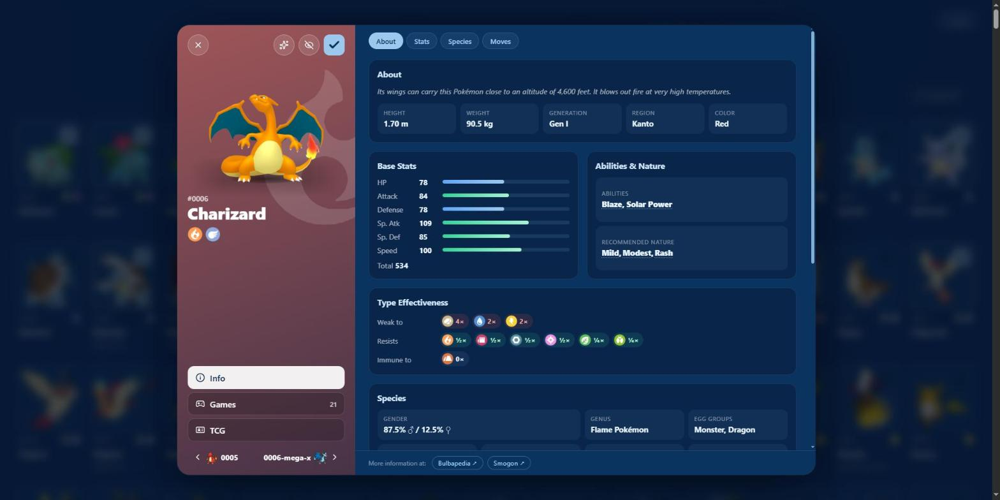
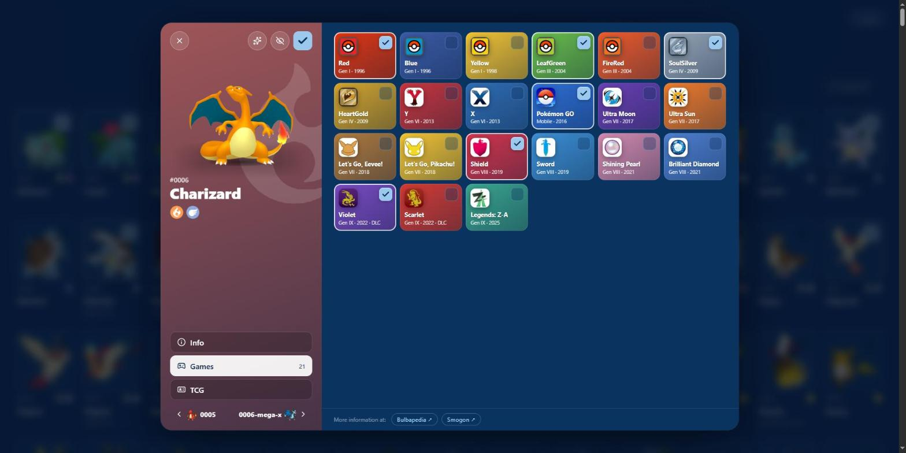
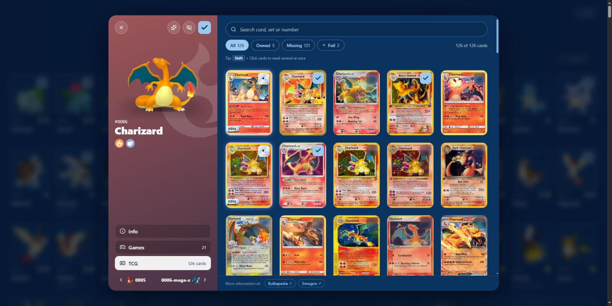
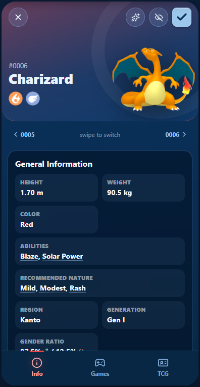

# Pokédex Collection Manager

A personal Pokédex app for tracking your Pokémon collection — Pokémon, the games they appear in and
their TCG cards — built as a fully static site deployable on GitHub Pages with no backend required.
Works on desktop and phone, and installs as an app (PWA).

**Live:** https://LydiaGarcia03.github.io/pokedex-collection-manager/



| Detail — Info | Detail — Games |
|---|---|
|  |  |

| Detail — TCG (foil cards) | Phone |
|---|---|
|  |  |

---

## Features

### Browsing
- Browse all 1288 Pokédex entries, including regional forms, Mega Evolutions and Gigantamax forms
- Search by name or Pokédex number
- Filter panel (tabs on desktop, bottom sheet on phone): collection (All / Owned / Missing), generation
  (Gen I–IX), type (plus Legendary, Mythical and Starter), game, and DLC (Isle of Armor, Crown Tundra,
  The Teal Mask, The Indigo Disk) when a single game with DLC is selected

### Pokémon detail
- **Desktop:** a fixed column in the Pokémon's type color — its first type's symbol in the corner,
  the Pokémon standing on the ground, quick actions (shiny, collection visibility, collected) and
  the Info / Games / TCG tabs. ← → switch Pokémon
- **Phone:** full-screen layout with a type-colored header, tabs at the bottom and swipe to switch
  Pokémon
- **Info:** section shortcuts, quick facts, base stats, abilities and recommended natures,
  type effectiveness (weak / resists / immune), species data and level-up / TM moves
- **Games:** every game the Pokémon appears in, as blocks in each game's color, with generation,
  release year and DLC. Each version of a pair (e.g. Scarlet vs Violet) shows its own exclusives
- **TCG:** the Pokémon's cards with local images, searchable by card name, set or number and
  filterable by All / Owned / Missing / Foil

### Collection tracking
- Mark Pokémon, games and TCG cards as collected; cards can also be marked as **foil**
- Desktop TCG: the corner box cycles *don't have → have → foil*; clicking a card opens it large
  with *No / Yes / Yes, foil*; **Shift+click** selects several cards to mark them all at once
- Phone TCG: tap a card to open it large and choose *No / Yes / Yes, foil*
- Foil cards show a FOIL tag and a rotating rainbow border, like the back of a CD
- "Toggle Collection Visibility" mode highlights only what you have

### Import / Export
- Export your collection as a text file (Pokémon only, with games, or with TCG cards)
- Import a previously exported collection file

### Cloud sync (requires login)
- Create an account or log in with email and password; reset a forgotten password by email
- Save multiple named collections to the cloud via Firestore
- Load any saved collection back — on login, the most recently updated collection loads automatically
- Overwrite or delete saved collections from the "My Collections" panel

### Installable app (PWA)
- "Add to Home Screen" opens it full screen with its own icon and splash screen
- The app shell is cached at install; images and data are cached as you browse

### Performance & security
- All images served locally — no external CDN calls at runtime (except shiny sprites)
- Moves are loaded per Pokémon when its detail opens, so the listing loads a small data file
- Firebase App Check with reCAPTCHA v3 protects all Firebase calls from bots and abuse
- Firestore rules restrict each user's data to their own account only

---

## Tech Stack

| Layer | Technology |
|-------|-----------|
| UI | React 19 + TypeScript |
| Build | Vite 8 |
| PWA | vite-plugin-pwa (Workbox) |
| Icons | Lucide React |
| Auth | Firebase Authentication (email/password) |
| Database | Firebase Firestore (cloud collection storage) |
| Security | Firebase App Check + reCAPTCHA v3 |
| Hosting | GitHub Pages (via GitHub Actions) |
| Data | Pre-compiled JSON + local images (~600 MB) |

---

## How It Works

All Pokémon data, TCG card metadata and images are pre-processed locally and committed to the
repository. At runtime the browser fetches the listing data (`pokemon-compiled.json`), each
Pokémon's moves (`moves/{id}.json`) when its detail opens, the TCG catalog, and all images from the
same GitHub Pages origin — no external API calls at runtime.

Collection state (selected Pokémon, cards, foil flags and games) is stored in `localStorage`.
Logged-in users can additionally save and load named collections to Firestore, which syncs across
devices.

Firebase App Check intercepts every Firebase SDK call and requires a valid reCAPTCHA v3 token.
Requests without a valid token — including direct API calls that bypass the site — are rejected by
Firebase before reaching Auth or Firestore.

---

## Data Sources

These sources are used only during local setup steps — the deployed site makes no runtime API calls.

| Source | Used for |
|--------|----------|
| [PokéAPI](https://pokeapi.co) | Pokémon data: stats, types, abilities, moves, species, game indices |
| [TCGdex](https://tcgdex.dev) | TCG card metadata, set names and images |
| [Serebii](https://www.serebii.net) | Card images TCGdex doesn't have yet; DLC Pokédex lists |
| [pokemon-tcg-data](https://github.com/PokemonTCG/pokemon-tcg-data), [pkmncards](https://pkmncards.com), [Limitless](https://limitlesstcg.com) | Remaining missing card images |

---

## Environment Variables

Create a `.env.local` file at the project root (never commit this file):

```
VITE_FIREBASE_API_KEY=
VITE_FIREBASE_AUTH_DOMAIN=
VITE_FIREBASE_PROJECT_ID=
VITE_FIREBASE_STORAGE_BUCKET=
VITE_FIREBASE_MESSAGING_SENDER_ID=
VITE_FIREBASE_APP_ID=
VITE_RECAPTCHA_SITE_KEY=
```

For GitHub Pages deployment, add each of these as a repository secret under
**Settings → Secrets and variables → Actions**.

---

## Project Setup (First Time)

> These steps are run once locally to generate and download all data before deploying.
> They require the sibling [`pokedex`](https://github.com/LydiaGarcia03/pokedex) project to exist at `../pokedex/`.
> `npm run setup` runs steps 2–5 in order.

### 1. Install dependencies
```powershell
npm install
```

### 2. Compile Pokémon data
Reads source JSON files from the sibling project and produces `public/data/pokemon-compiled.json`
(listing and detail data) plus one `public/data/moves/{id}.json` per Pokémon.
```powershell
npm run compile-data
```

### 3. Collect TCG card metadata
Calls the TCGdex API (~900 requests, ~5 minutes) and produces `public/data/tcg-cards.json` and
`public/data/tcg-sets.json`. It merges with the existing catalog, so no card is ever removed.
```powershell
npm run collect-tcg
```

### 4. Fill in missing card images (optional, re-run anytime)
Cards TCGdex has no image for yet are looked up on Serebii, then on the other free sources.
Whatever is still missing is listed in `scripts/tcg-missing-images.json` and shown as a
name / set / number placeholder.
```powershell
npm run fetch-serebii-tcg
npm run fetch-fallback-tcg
```

### 5. Download all images
Downloads the Pokémon sprites and ~20,000 TCG card images. Skips files already downloaded.
```powershell
npm run download-images
```
Estimated time: ~20 minutes.

### 6. Type symbols (only if the type icons change)
Generates the big type symbol masks used in the desktop detail (`public/images/types/symbol-*.png`).
Needs Python with Pillow.
```powershell
python scripts/generate-type-symbols.py
```

### 7. Commit data and images
```powershell
git add public/data/pokemon-compiled.json public/data/moves/
git add public/data/tcg-cards.json public/data/tcg-sets.json public/data/type-chart.json
git add public/images/
git commit -m "Add compiled data and local images"
git push
```

GitHub Actions builds and deploys to GitHub Pages automatically on push to `main`.

---

## Development

```powershell
npm run dev
```

Opens at `http://localhost:5175`. No backend needed — all data is served from `public/`.

In development, Firebase App Check uses a debug token instead of reCAPTCHA. On first run, the
browser console prints:

```
App Check debug token: <uuid>
```

Register this token in **Firebase Console → App Check → [your app] → Manage debug tokens** so local
auth works without reCAPTCHA.
